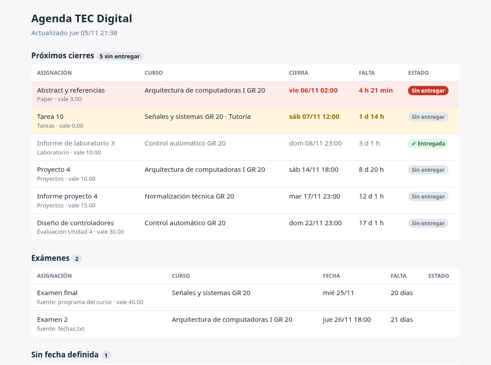
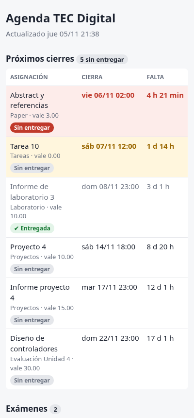

# Agenda TEC Digital

Herramienta personal que revisa cada hora mis cursos en **TEC Digital** (la plataforma del
Tecnológico de Costa Rica), detecta asignaciones nuevas, cambios de fecha y el estado de cada
entrega, y me avisa a tiempo: notificaciones, correos de recordatorio, un resumen los lunes,
un cierre de semana los viernes y un panel que puedo abrir desde el celular.

> **English summary:** a personal productivity tool that polls my university's LMS (TEC Digital,
> based on .LRN) every hour, tracks assignments, deadlines, submission status and exam dates
> (including dates parsed from course syllabus PDFs), and sends reminders and weekly email digests.
> Python + requests/BeautifulSoup, SQLite, systemd timers, SMTP, and a private mobile dashboard
> served over Tailscale. Includes an offline test suite.

<p align="center">
  
  &nbsp;
  
</p>
<p align="center"><sub>Capturas generadas con datos de ejemplo (<code>python3 demo.py</code>).</sub></p>

## Qué hace

- **Lee la pestaña Evaluaciones** de cada curso del semestre actual y de sus subgrupos (por
  ejemplo, las tutorías): fecha de cierre, valor, nota y si ya entregué.
- **Avisa** cuando aparece una asignación nueva o cambia una fecha, y recuerda 48 h, 24 h y 3 h
  antes de cada cierre. Todo esto **solo si no he entregado**.
- **Correo "cierra en menos de 2 horas"** para lo que todavía no he entregado.
- **Fechas de examen**: las saca del PDF del *Programa del curso* y de un archivo `fechas.txt`
  para lo que se define en clase. Recuerda 3 días y 1 día antes.
- **Correos semanales**: el lunes, lo que viene en la semana; el viernes, el cierre de semana
  (qué entregué, qué se pasó, notas nuevas y lo que viene).
- **Panel HTML** con lo pendiente, el estado de cada entrega y colores por urgencia; se adapta al
  celular y al modo oscuro.

## Cómo funciona

```
 systemd timer (cada hora) ──► tec_agenda.py
                                 │ 1. inicia sesión (API JSON del login)
                                 │ 2. Mi portal → cursos del semestre actual (+ subgrupos)
                                 │ 3. Evaluaciones de cada curso  ─┐
                                 │ 4. Programa del curso (PDF)    ─┤─► SQLite (agenda.db)
                                 │ 5. fechas.txt                  ─┘
                                 ├─► avisos: notify-send / ntfy / correo (SMTP)
                                 └─► panel.html ──► servir_panel.py (127.0.0.1) ──► Tailscale ──► celular
 timers lunes 7:00 / viernes 20:00 ──► tec_agenda.py --resumen / --cierre-semana ──► correo
```

Algunos detalles que resolví en el camino:

- **El login no es un formulario HTML**: es una app de Angular. Leyendo su código encontré que
  envía un JSON a `/api/login/new-form/` y responde con un `status` (`ok`, `bad_password`,
  `muchos_intentos`…), así que el script hace lo mismo y explica el error si falla.
- **El HTML de "Mi portal" viene mal cerrado**: el bloque del semestre actual se "traga" a los
  semestres anteriores (salían 26 cursos en vez de 5). Lo resolví tomando el periodo del primer
  curso del bloque (p. ej. `S-2-2026`) y filtrando por él.
- **Fechas de examen en PDF**: se extrae el texto con `pdftotext -layout` y se buscan las filas
  de la tabla de evaluación. Para juntar fuentes, `"Primer examen parcial"` y
  `"Examen Parcial 1"` se reconocen como el mismo examen (`parcial1`).
- **Sin avisos repetidos**: cada aviso enviado se guarda en SQLite. Un curso que aparece por
  primera vez no dispara un aviso por cada asignación vieja.
- **Panel privado**: `servir_panel.py` escucha solo en `127.0.0.1` y entrega **únicamente**
  `panel.html` (cualquier otra ruta da 404, hay una prueba para eso); Tailscale lo pasa a mis
  dispositivos sin dejarlo público en internet.

## Instalación

Requisitos: Linux con systemd, Python 3.10+ y `pdftotext` (paquete `poppler-utils`) para leer
los programas de curso.

```bash
git clone https://github.com/walle-au/tec-digital-agenda.git
cd tec-digital-agenda
pip install -r requirements.txt        # o: sudo apt install python3-requests python3-bs4

cp .env.example .env && chmod 600 .env  # solo tú puedes leerlo
nano .env                                # usuario y contraseña de TEC Digital
cp fechas.example.txt fechas.txt         # opcional: exámenes definidos en clase

python3 tec_agenda.py                    # primera revisión (guarda todo sin avisar de "nuevas")
xdg-open panel.html
```

### Que corra solo

```bash
./instalar.sh               # revisión cada hora + correos lunes/viernes + servidor del panel
./instalar.sh --sin-panel   # lo mismo, sin el servidor del panel
systemctl --user list-timers           # ver cuándo corre
journalctl --user -u tec-agenda -n 30  # ver el último resultado
```

### Correos (opcional)

Con Gmail se usa una **contraseña de aplicación** (requiere verificación en 2 pasos), creada en
<https://myaccount.google.com/apppasswords>. En `.env`:

```
SMTP_USUARIO=tu_correo@gmail.com
SMTP_CLAVE=xxxx xxxx xxxx xxxx
CORREO_PARA=            # vacío = te lo manda a ti mismo
```

Probar: `python3 tec_agenda.py --resumen` (lunes) o `python3 tec_agenda.py --cierre-semana` (viernes).

### Avisos al celular con ntfy (opcional)

Instala la app **ntfy**, suscríbete a un tema con un nombre difícil de adivinar y ponlo en
`NTFY_TOPIC` dentro de `.env`.

### Panel en el celular con Tailscale (opcional)

1. Instala Tailscale en la compu y en el celular, con la misma cuenta.
2. `sudo tailscale set --operator=$USER` (una vez).
3. `tailscale serve --bg 8765` → te da una dirección `https://<compu>.<tailnet>.ts.net/`.

Solo tus dispositivos conectados a Tailscale pueden abrirla. Para apagarlo:
`tailscale serve --https=443 off`.

## Pruebas

```bash
python3 -m unittest -v
```

Corren sin conexión, con páginas de ejemplo que imitan la estructura real: lectura de
Evaluaciones, filtro del semestre con el HTML mal cerrado, fechas de examen del PDF y de
`fechas.txt`, prioridad entre fuentes, lógica de avisos (ventanas, nada si ya entregué, sin
repetidos, cursos nuevos) y que el servidor del panel no entregue `.env` ni otros archivos.

## Estructura

| Archivo | Qué es |
|---|---|
| `tec_agenda.py` | El programa: sesión, lectores, base de datos, avisos, panel y correos |
| `servir_panel.py` | Servidor mínimo que entrega solo `panel.html` en `127.0.0.1:8765` |
| `instalar.sh`, `systemd/` | Servicios y timers de systemd (plantillas con la ruta de la carpeta) |
| `demo.py` | Genera el panel y un correo con datos inventados (`docs/`) |
| `tests/` | Pruebas automáticas |
| `.env.example`, `fechas.example.txt` | Plantillas de configuración |

## Privacidad

- Las credenciales viven solo en `.env` (permisos `600`), que nunca se sube al repositorio.
- `agenda.db`, `panel.html` y `fechas.txt` contienen datos personales y también están excluidos.
- El script usa únicamente **tu propia cuenta** y lee lo mismo que ves en el navegador, a un ritmo
  bajo (una revisión por hora; los PDF de los programas se descargan como mucho una vez al día).

## Aviso

Proyecto personal, no oficial y sin relación con el Tecnológico de Costa Rica. Si TEC Digital
cambia su estructura, el lector puede necesitar ajustes.

## Licencia

[MIT](LICENSE)
